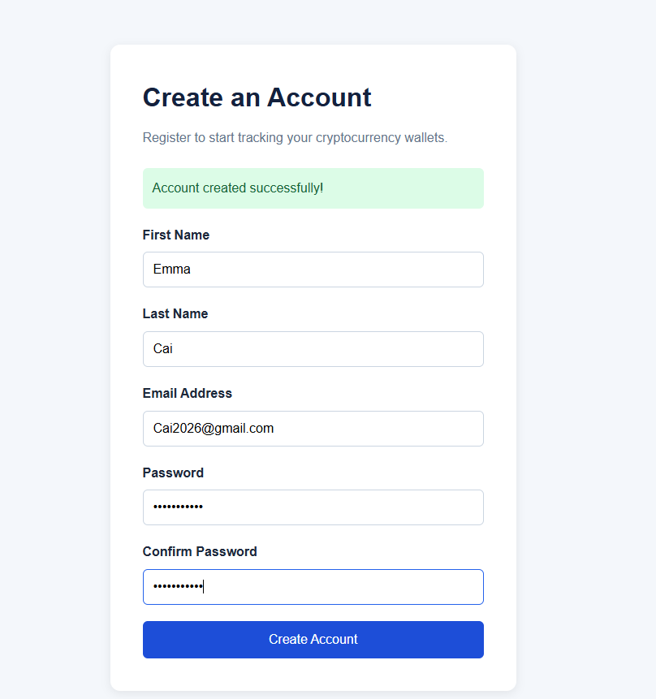
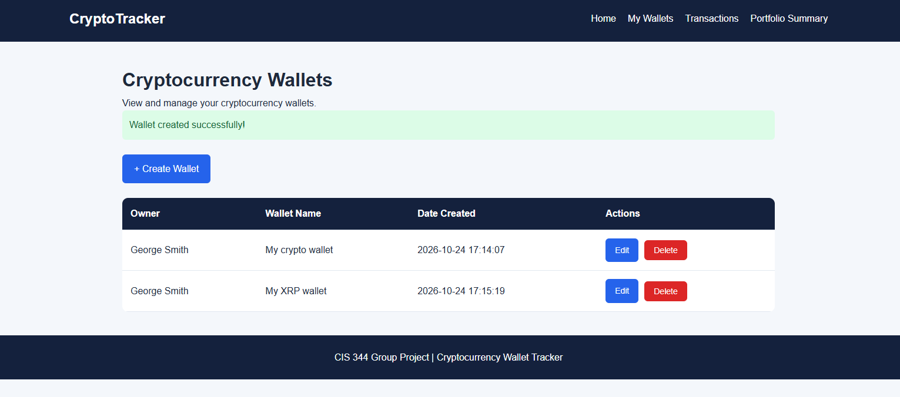
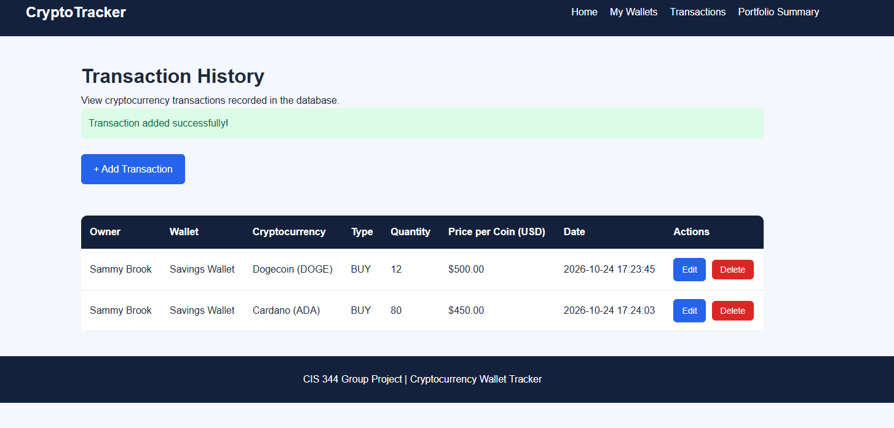
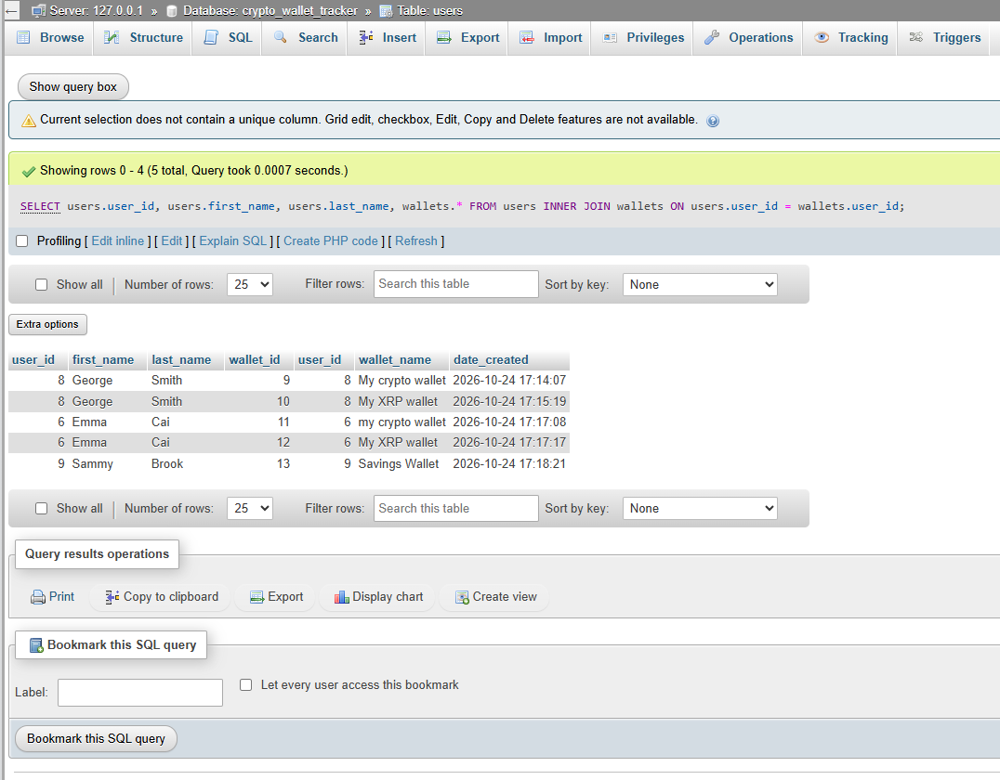
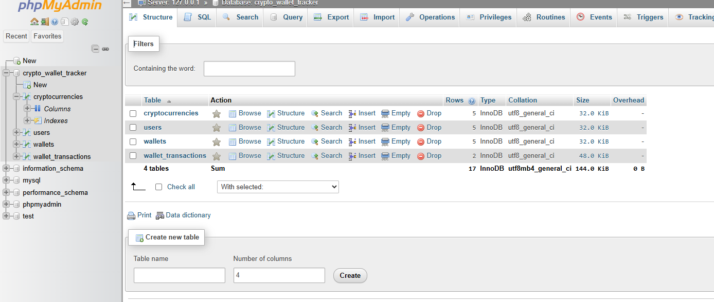
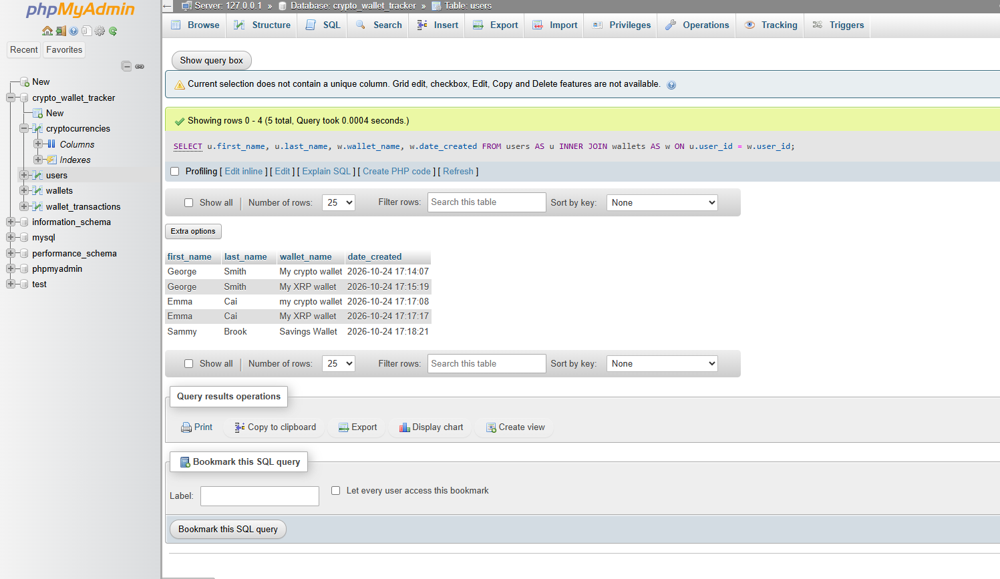

# Cryptocurrency Wallet Tracker

**CIS 344 - Group Project**

## Project Overview

The Cryptocurrency Wallet Tracker is a web-based application developed using PHP, MySQL, HTML, and CSS.

The application allows users to create and manage cryptocurrency wallets, record transactions, and monitor their cryptocurrency holdings.

This project demonstrates relational database design, SQL queries, database relationships, PHP and MySQL integration, and CRUD operations.

## Technologies Used

- **Frontend:** HTML and CSS
- **Backend:** PHP
- **Database:** MySQL
- **Database Design:** MySQL Workbench
- **Development Environment:** Visual Studio Code and XAMPP
- **Version Control:** Git and GitHub

## Main Features

- User registration and login
- Secure password hashing and PHP sessions
- Create, view, edit, and delete cryptocurrency wallets
- Add, view, edit, and delete cryptocurrency transactions
- Track cryptocurrency purchases, sales, deposits, and withdrawals
- Calculate cryptocurrency balances automatically
- Prevent transactions that exceed available holdings
- Restrict access to wallets and transactions belonging to other users
- Display supported cryptocurrencies

## Database Design

The database is named `crypto_wallet_tracker` and contains four main tables:

| Table | Description |
|---|---|
| `users` | Stores registered user information |
| `wallets` | Stores wallets belonging to users |
| `cryptocurrencies` | Stores supported cryptocurrencies |
| `wallet_transactions` | Records cryptocurrency transactions |

### Database Relationships

- One user can own multiple wallets.
- One wallet can contain multiple transactions.
- One cryptocurrency can appear in multiple transactions.

The database uses primary keys, foreign keys, and other constraints to maintain data integrity.

### SQL Concepts Implemented

- CREATE TABLE
- INSERT, SELECT, UPDATE, DELETE
- INNER JOIN
- LEFT JOIN
- GROUP BY
- SUM()
- CASE
- Aggregate queries
- Prepared statements

## Installation Instructions

### 1. Download the project

Clone the GitHub repository:

`git clone https://github.com/jorgeg365/Cryptocurrency-Wallet-Tracker.git crypto_wallet_tracker`

Place the project folder in your XAMPP `htdocs` directory.

### 2. Start the local server

Start Apache through the XAMPP Control Panel.

Make sure a MySQL server is running and accessible. You can use either an existing MySQL Server installation or XAMPP's MySQL-compatible server with matching connection settings.

### 3. Import the database

Open MySQL Workbench and import these files in order:

1. `database/crypto_wallet_tracker_schema.sql`
2. `database/crypto_wallet_tracker_seed.sql`

The schema script creates the tables and relationships. Make sure the database `crypto_wallet_tracker` exists or is created by the schema script before importing.

The seed script inserts Bitcoin, Ethereum, Solana, Cardano, and Dogecoin.

**Warning:** The schema export may contain DROP TABLE statements. Import it into a fresh development database rather than one containing data you need to preserve.

### 4. Configure the database connection

Inside the `includes` folder:

1. Copy `db.example.php`.
2. Rename the copy to `db.php`.
3. Enter your local MySQL hostname, port, username, and password.
4. Ensure the database name is `crypto_wallet_tracker`.

The actual `db.php` file is excluded from Git tracking to protect local database credentials.

### 5. Open the application

Visit:

`http://localhost/crypto_wallet_tracker/`

Register a new account, log in, and begin creating cryptocurrency wallets and transactions.

## Project Structure

- `index.php` — Homepage
- `register.php` — User registration
- `login.php` — User authentication
- `logout.php` — Ends user sessions
- `wallets.php` — Displays user wallets
- `create_wallet.php` — Creates wallets
- `edit_wallet.php` — Updates wallet names
- `delete_wallet.php` — Deletes eligible wallets
- `transactions.php` — Displays transaction history
- `add_transaction.php` — Records transactions
- `edit_transaction.php` — Updates transactions
- `delete_transaction.php` — Deletes eligible transactions
- `portfolio.php` — Calculates cryptocurrency holdings
- `includes/` — Database connection configuration
- `css/` — Website styling
- `database/` — SQL scripts and EER diagram

## Security Features

The application implements password hashing, PHP sessions, prepared SQL statements, form validation, and user-specific database queries.

Access to protected pages requires authentication. Users can manage only wallets and transactions associated with their accounts.

## Project Scope

This application is an educational cryptocurrency tracking system. It records manually entered cryptocurrency transactions and calculates holdings using database information.

It does not connect to real cryptocurrency wallets, execute trades, or retrieve live market prices.

## Database Testing and Results
We tested our Cryptocurrency Wallet Tracker application using XAMPP, PHP, MySQL, and phpMyAdmin.

During testing, we registered five user accounts, created five cryptocurrency wallets, and added two cryptocurrency transactions through the website.

We used SQL queries to verify that the information was saved correctly in the database.
SQL Queries Tested

INNER JOIN: Connected users with their cryptocurrency wallets.

LEFT JOIN: Displayed users, including those without wallets.

GROUP BY: Counted the number of wallets owned by each user.

Three-Table INNER JOIN: Connected users, wallets, and wallet transactions.

Four-Table INNER JOIN: Connected users, wallets, wallet transactions, and cryptocurrencies.

Four-Table INNER JOIN Results

Our final SQL query successfully displayed two transactions from the Savings Wallet belonging to Sammy Brook.

The first transaction was a purchase of 12 Dogecoin (DOGE), and the second was a purchase of 80 Cardano (ADA).

These results confirmed that the PHP application saved transaction information in MySQL and that the database tables could be connected using SQL queries.

## Project Screenshots

### User Registration

### Cryptocurrency Wallets

### Cryptocurrency Transactions

### Database Tables

### Four-Table INNER JOIN

### GROUP BY Results

### Users and Wallets INNER JOIN

## Group Information

**Course:** CIS 344

**Project:** Cryptocurrency Wallet Tracker

**Team:** Three group members

## Repository

[Cryptocurrency Wallet Tracker on GitHub](https://github.com/jorgeg365/Cryptocurrency-Wallet-Tracker)

---

